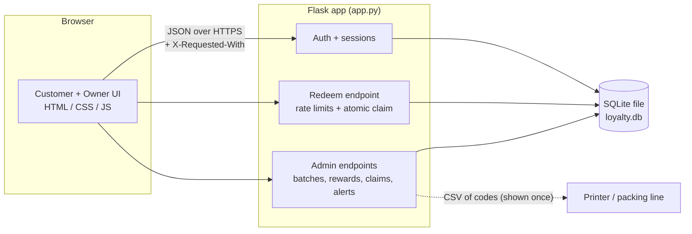
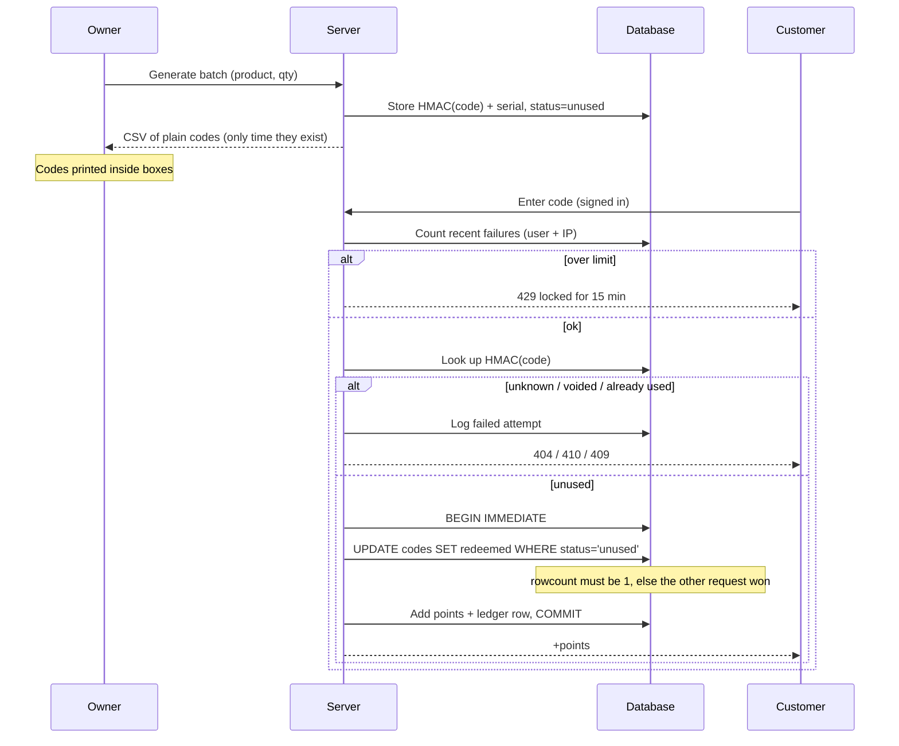
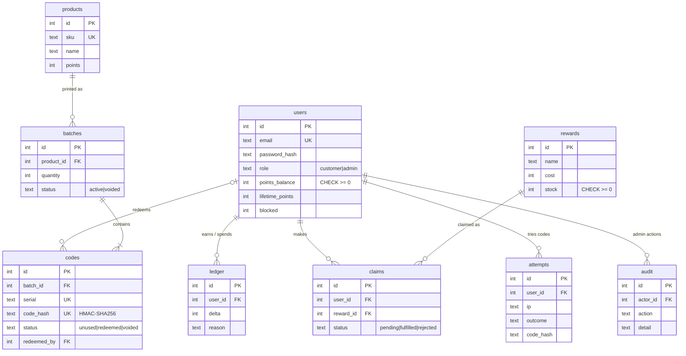

# Architecture

## Stack and why

| Layer | Choice | Reason |
|---|---|---|
| Backend | **Python 3 + Flask** | Small, readable, easy to explain line by line. Test client makes API tests fast. |
| Database | **SQLite** (WAL mode) | No server to install, one file, real transactions and constraints. `BEGIN IMMEDIATE` gives the atomic redemption the design depends on. |
| Front end | **Vanilla JavaScript + CSS**, hash router, no build step | Nothing to compile. Any grader can open it. Works on phones. Served by Flask as static files. |
| Auth | Server-side signed session cookie (`HttpOnly`, `SameSite=Lax`), Werkzeug password hashing | No tokens in JavaScript, nothing to steal via XSS. |
| Tests | Python `unittest` | Standard library, no extra install. |
| Deploy | `gunicorn "app:create_app()"` | Standard WSGI. |

## Components

## How a customer proves a purchase (and why reuse fails)

## Data model

Full DDL: [`schema.sql`](schema.sql).

## Fraud prevention: layers

| Threat | Defence |
|---|---|
| Reusing a code (same or different account) | Single atomic `UPDATE … WHERE status='unused'`. The `status` column and the `UNIQUE code_hash` live in the database, not in app memory. |
| Two requests at the same instant | `BEGIN IMMEDIATE` serialises writers. Tested with 8 parallel requests: exactly one succeeds. |
| Guessing codes | 60-bit random codes + 5 failures per 15 min per user + 20 per hour per IP. Even valid codes are refused while locked. |
| Stolen database | Only keyed hashes of codes are stored. Passwords are salted hashes. |
| Stolen or misprinted batch | Owner cancels unused codes in one click. |
| Credential stuffing | 10 failed logins per IP per 15 min. |
| Cross-site request forgery | `SameSite=Lax` cookie + required `X-Requested-With` header on every write. |
| XSS | All dynamic text is HTML-escaped in the UI. Strict Content-Security-Policy (no inline scripts). |
| Privilege escalation | Every `/api/admin/*` route uses `admin_required`. Tested: customers get 403, anonymous gets 401. |
| Over-spending points / stock | Guarded `UPDATE … WHERE points_balance >= cost` and `stock > 0`, plus `CHECK` constraints. |
| Detection | `attempts` table feeds the owner's **Fraud alerts** page: accounts with repeat failures, noisy IPs, codes many people try to reuse. `audit` records every owner action. |

## Database connection

`db.py` opens one SQLite connection per request (`sqlite3.connect(DB_PATH)`, autocommit, `foreign_keys=ON`, WAL, 15 s busy timeout). `DB_PATH` comes from `.env`. Open the file with any SQLite viewer (for example *DB Browser for SQLite*) or `sqlite3 loyalty.db`.

**Moving to PostgreSQL later:** only `db.py` and the `datetime('now')` / `date()` expressions in `app.py` and `schema.sql` are SQLite-specific. The rest is standard SQL. The atomic `UPDATE … WHERE status='unused'` pattern works unchanged in PostgreSQL.

## Known limitations

- SQLite allows one writer at a time. Fine for one factory; use PostgreSQL for very high traffic.
- Behind a reverse proxy, configure the proxy to pass the real client IP (otherwise IP limits see the proxy's address).
- No email verification or password reset yet.
- A lost code CSV cannot be recovered by design.
