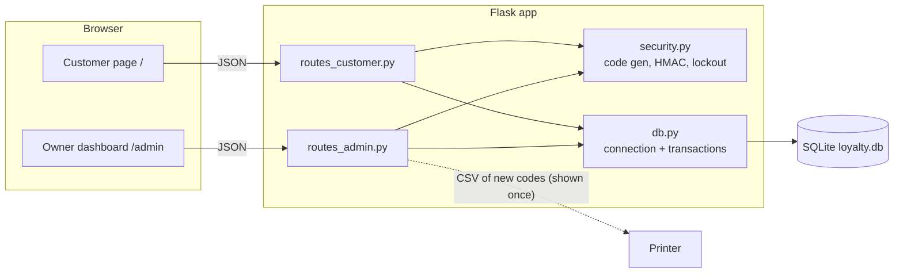
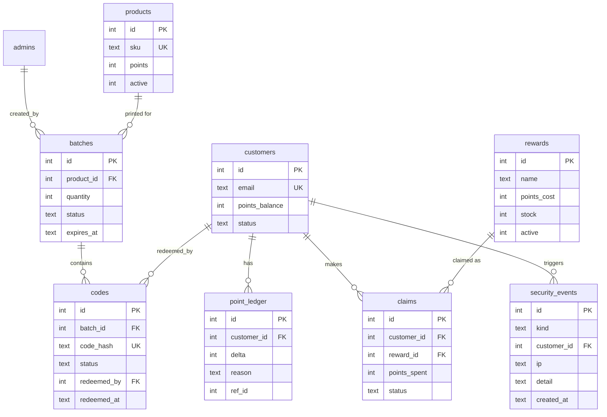

# Architecture

## Stack and reasons
| Choice | Reason |
|---|---|
| **Python + Flask** | Small, readable, easy to explain end to end. The API is a handful of JSON endpoints. |
| **SQLite (stdlib `sqlite3`)** | Zero setup, single file, ACID transactions and `BEGIN IMMEDIATE` give the exact atomicity needed for single-use codes. No ORM keeps every SQL statement visible and explainable. |
| **Vanilla JS + CSS** | Two small pages. A framework and a build step would add moving parts with no benefit. Strict CSP: no inline scripts; all dynamic values are escaped. |
| **Werkzeug password hashing (scrypt)** | Maintained, salted, slow by design. |
| **HMAC-SHA256 with a secret pepper** | Used for stored code hashes and for the checksum characters. |
| **unittest** | Standard library, runs anywhere. |

Upgrade path: swap `app/db.py` for PostgreSQL (the SQL is mostly standard) when more than one server is needed.

## System diagram


## Redemption flow (the fraud-critical path)
```mermaid
sequenceDiagram
    participant U as Customer
    participant API as /api/redeem
    participant DB as SQLite
    U->>API: code
    API->>API: account active? locked out? (events table)
    API->>API: normalise + checksum (offline)
    API->>DB: BEGIN IMMEDIATE
    API->>DB: lookup HMAC(code) joined to batch + product
    alt not found / voided / expired / used
        API->>DB: ROLLBACK/COMMIT (nothing written)
        API->>DB: log security_event (counts towards lockout)
        API-->>U: error
    else valid
        API->>DB: UPDATE codes SET redeemed WHERE id=? AND status='unused'
        API->>DB: INSERT ledger +points; UPDATE balance
        API->>DB: COMMIT
        API-->>U: points earned
    end
```

## Data model


## Fraud controls summary
| Threat | Control |
|---|---|
| Guessing codes | 31^12 random space, offline checksum, per-user and per-IP lockout, every failure logged |
| Reusing a code (one or many accounts) | Atomic conditional `UPDATE`; second attempt gets 409 and is logged with who used it first |
| Two simultaneous redemptions | `BEGIN IMMEDIATE` + conditional update; tested with 8 parallel requests |
| Database leak | Codes stored only as keyed hashes |
| Compromised or misprinted batch | Void batch; expiry dates |
| Overspending points / overselling stock | Conditional updates in one transaction; tested concurrently |
| Credential stuffing | Login throttling per IP; scrypt hashes |
| CSRF / XSS | SameSite cookies, JSON-only writes, strict CSP, output escaping |
| Suspicious accounts | Failure counts per customer, one-click suspend |

## Code layout
```
app/
  __init__.py        app factory, headers, admin bootstrap
  config.py          env vars + refuses placeholder secrets
  db.py              connection, transaction() helper, schema init
  schema.sql         tables and indexes
  security.py        code generation/validation, hashing, lockout
  routes_customer.py customer API
  routes_admin.py    owner API
  static/            customer.html, admin.html, app.css, *.js
scripts/             init_env.py, seed_demo.py
tests/               test_api.py
```
